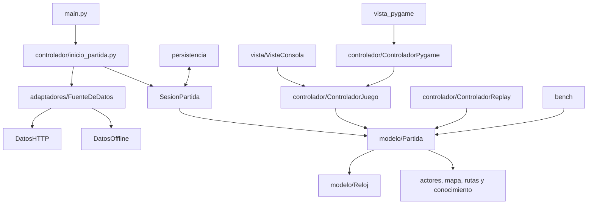

# Arquitectura del proyecto

CRIPTA separa las reglas de la partida de la interfaz, el acceso a datos y la persistencia. Esta división permite ejecutar las mismas reglas desde consola, Pygame, replay y benchmarks.

## Componentes principales

| Área | Responsabilidad |
| --- | --- |
| `main.py` | Valida opciones y selecciona partida nueva, verificación, replay o benchmark. |
| `modelo/` | Mantiene el estado y las reglas: reloj, movimiento, enemigos, puertas, rutas, conocimiento, combate y efectos. |
| `controlador/` | Traduce comandos en acciones, coordina sesiones y conecta modelo, vistas y persistencia. |
| `vista/` | Presenta el juego y recibe comandos desde la consola. |
| `vista_pygame/` | Presenta el mismo modelo con escenas, controles, renderizado y audio. |
| `adaptadores/` | Implementa las fuentes HTTP y offline detrás del contrato común de datos. |
| `estructuras/` | Contiene estructuras propias utilizadas por los módulos del juego. |
| `persistencia/` | Serializa partidas, cachés y registros versionados. |
| `bench/` | Ejecuta mediciones aisladas y produce reportes de rendimiento. |

## Flujo de una partida

1. `main.py` valida argumentos y crea la fuente de datos seleccionada.
2. `controlador/inicio_partida.py` carga y valida el esqueleto de la cripta y construye la sesión.
3. `ControladorJuego` obtiene un comando de la vista y solicita al modelo ejecutar la acción.
4. `Partida` aplica las reglas y usa `Reloj` para procesar actores y efectos por tiempo virtual.
5. El controlador comunica a la vista los mensajes y el estado que se puede presentar.
6. Guardado, carga, replay y consultas históricas reutilizan el estado y los contratos del modelo.

El modelo no depende de Pygame ni imprime directamente a la consola. La vista presenta resultados, pero no decide movimiento, combate, orden de eventos ni conocimiento del jugador.

## Datos y fuentes

`adaptadores/FuenteDeDatos` define las operaciones de lectura necesarias para iniciar partidas y cargar contenido. `DatosHTTP` encapsula solicitudes al servicio externo. `DatosOffline` lee los snapshots incluidos en `datos_offline/` y selecciona el catálogo que corresponde a cada cripta.

Las cachés persistentes y de memoria reducen lecturas repetidas. Los datos se validan por identidad y versión antes de incorporarse a una partida. El modo offline no realiza solicitudes HTTP.

## Tiempo, eventos y determinismo

`modelo/Reloj` administra los eventos mediante una agenda ordenada por tiempo y secuencia de inserción. El movimiento y los efectos usan tiempo virtual; las esperas de red y la interacción humana no adelantan el reloj del juego.

La semilla y la bitácora de acciones permiten repetir una partida. `--replay` reconstruye la secuencia sin solicitar comandos interactivos. Los benchmarks crean sus propios casos y tampoco instancian una vista.

## Persistencia e historia

`persistencia/PartidaBinaria.py` almacena un índice de salas y bloques de estado. `controlador/guardado.py` valida las versiones y restaura la sesión antes de reemplazar la partida activa.

La línea de tiempo mantiene acciones y puntos de control para reconstruir estados históricos sin modificar la partida vigente. El pergamino de retroceso utiliza los deltas reversibles del modelo; es un mecanismo separado de las consultas históricas.

## Interfaces

La consola y Pygame comparten las reglas y el modelo. Pygame recibe comandos mediante su controlador y presenta snapshots de estado y eventos; no calcula decisiones de juego. Los modos `--replay` y `--bench` funcionan sin cargar la interfaz gráfica.

Los comandos, controles y ejemplos de ejecución están en el [README principal](../README.md). Los requisitos y contratos de cada capacidad se encuentran bajo [`specs/`](../specs/).
